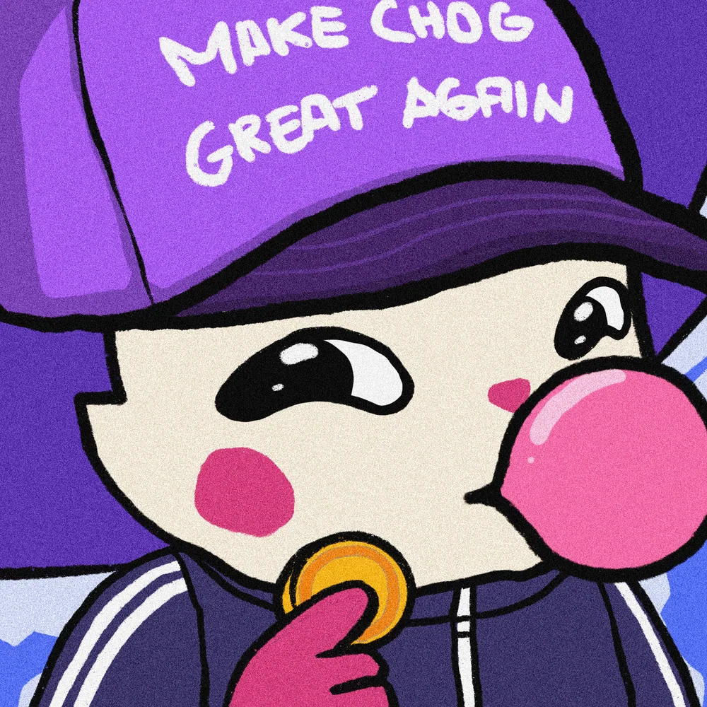
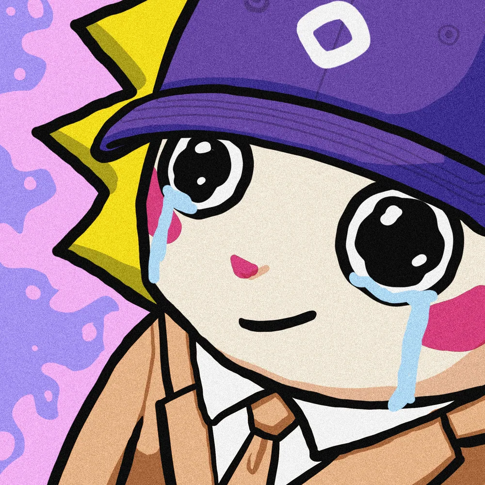
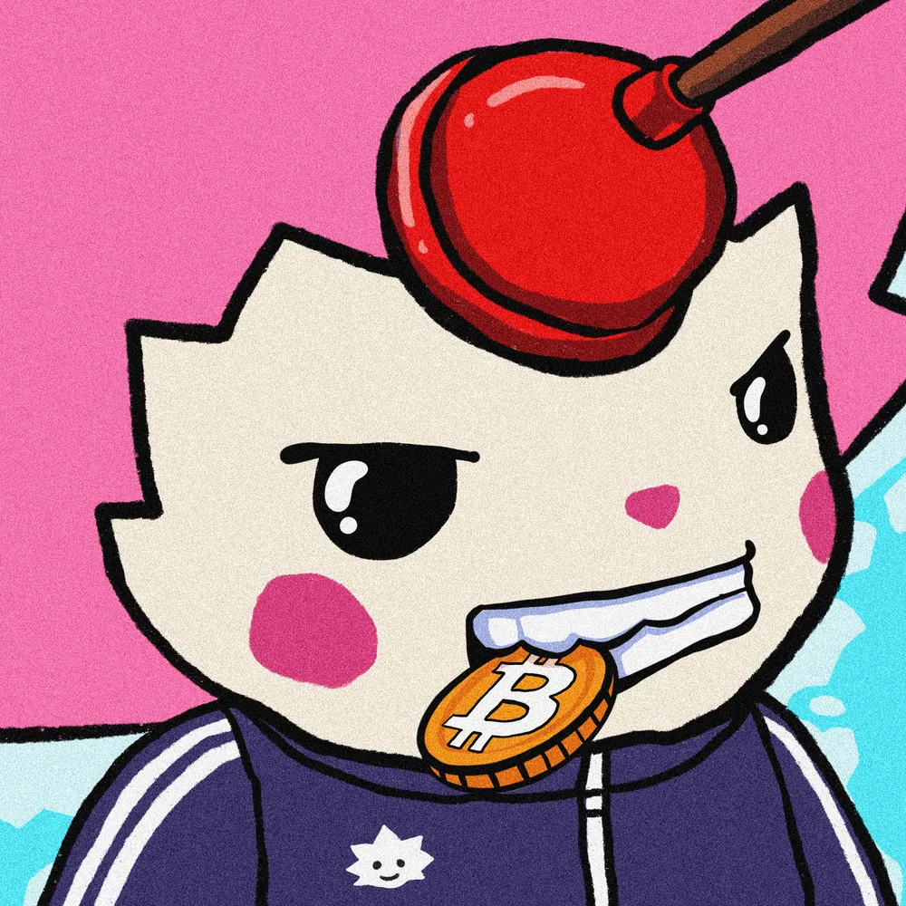
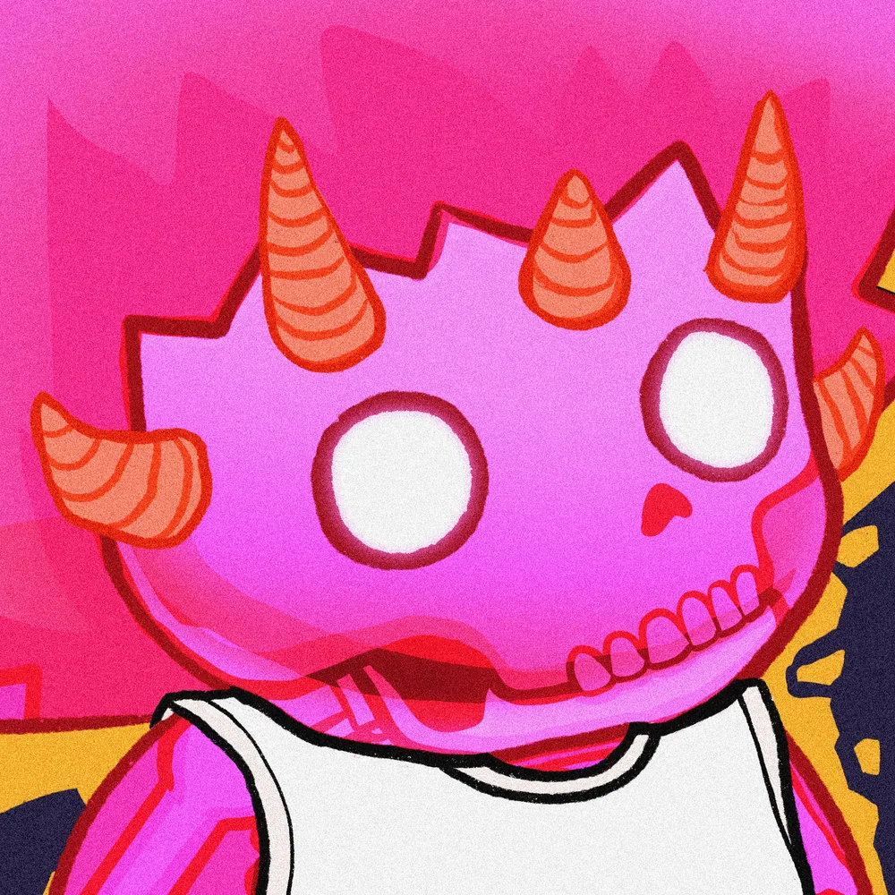

# Pip — authentic Chog Genesis candidate gallery

**Awaiting user approval. No candidate selected.** Pip is a fictional nickname, not an official collection rename, endorsement, or statement about a holder. Confirm artwork usage rights before publishing derivative story art; NFT existence/ownership alone is not a copyright license.

- Web gallery: **`/archive/pip-candidates`** (`npm run dev`, or a local production build).
- [Full gallery screenshot](review/pip-gallery-desktop.jpg) — browser capture, not a deployed-site claim.
- [Machine-readable provenance and all traits](../public/nft-candidates/provenance.json).
- Monad chain **143**, canonical collection [`0xc96d31f8626c6d03fae5dcd3d61e3fb9f4a73763`](https://monadvision.com/address/0xc96d31f8626c6d03fae5dcd3d61e3fb9f4a73763), collection name **Chog Genesis**.
- Verified at block **115047581**, runner timestamp **2026-10-20T13:05:53.713Z**. `ownerOf` succeeded for all four (addresses discarded); `tokenURI` was read at the same block. This is a dated RPC snapshot, not a holder consent or transaction.
- Each metadata description: “CHOG — a 1969-piece collection on Monad.”

| Onchain token ID | Metadata/artwork name | Original unaltered artwork |
| --- | --- | --- |
| **1969** | **CHOG #1461** |  |
| **969** | **CHOG #461** |  |
| **42** | **CHOG #1503** |  |
| **1968** | **CHOG #1460** |  |

## Candidate 1969 / CHOG #1461

**Fictional fit:** A smirking, bubblegum-chewing archive scout could give Pip a playful mask for moments of real danger.

**Original traits:** Background: Deep Blue; Aura: Smoke; Base: Origin; Skin: Origin; Side: Left; Body: dark jacket; Mouth: Bubblegum; Eyes: Smirk; Head: Chog Cap; Accessory: Coin; Form: Chog; Tier: Uncommon; Naked: No.

[Metadata](https://gateway.pinata.cloud/ipfs/bafybeid4ybujnscdipkno7ps5utqelp5ry5ryreqhay3zhgk3a6x4jruqu/1461.json) · [Original image](https://gateway.pinata.cloud/ipfs/bafybeihau2egcccbdxymeckmmbrqytbfor5gkt3en6d5fsbueymdbq7g6e/1461.webp) · [OpenSea token 1969](https://opensea.io/item/monad/0xc96d31f8626c6d03fae5dcd3d61e3fb9f4a73763/1969)

## Candidate 969 / CHOG #461

**Fictional fit:** The tearful eyes and cream tuxedo could make Pip a tender-hearted keeper of memories who finds courage beside Neri.

**Original traits:** Background: Soft Lavender; Aura: Light Purple; Base: Origin; Skin: Yellow; Side: Right; Body: Cream Tuxedo; Mouth: normal smile; Eyes: Round Tear; Head: Mon Cap; Form: Chog; Tier: Common; Naked: No.

[Metadata](https://gateway.pinata.cloud/ipfs/bafybeid4ybujnscdipkno7ps5utqelp5ry5ryreqhay3zhgk3a6x4jruqu/461.json) · [Original image](https://gateway.pinata.cloud/ipfs/bafybeihau2egcccbdxymeckmmbrqytbfor5gkt3en6d5fsbueymdbq7g6e/461.webp) · [OpenSea token 969](https://opensea.io/item/monad/0xc96d31f8626c6d03fae5dcd3d61e3fb9f4a73763/969)

## Candidate 42 / CHOG #1503

**Fictional fit:** The plumber headwear and dark jacket could frame Pip as a practical escape-route tinkerer with an eye for hidden mechanisms.

**Original traits:** Background: Deep Aqua; Aura: Smoke; Base: Origin; Skin: Pink; Side: Left; Body: dark jacket; Mouth: BTC Coin; Eyes: Base; Head: Plumber; Form: Chog; Tier: Uncommon; Naked: No.

[Metadata](https://gateway.pinata.cloud/ipfs/bafybeid4ybujnscdipkno7ps5utqelp5ry5ryreqhay3zhgk3a6x4jruqu/1503.json) · [Original image](https://gateway.pinata.cloud/ipfs/bafybeihau2egcccbdxymeckmmbrqytbfor5gkt3en6d5fsbueymdbq7g6e/1503.webp) · [OpenSea token 42](https://opensea.io/item/monad/0xc96d31f8626c6d03fae5dcd3d61e3fb9f4a73763/42)

## Candidate 1968 / CHOG #1460

**Fictional fit:** The red palette, horns and burning aura could make Pip an intimidating-looking guardian whose loyalty surprises Neri.

**Original traits:** Background: Radioactive; Aura: Burning Aura; Base: Radioactive; Skin: Red; Side: Left; Body: White Sleeveless; Eyes: Red Round Eye; Head: Demon Horn; Form: Chog; Tier: Epic; Naked: No.

[Metadata](https://gateway.pinata.cloud/ipfs/bafybeid4ybujnscdipkno7ps5utqelp5ry5ryreqhay3zhgk3a6x4jruqu/1460.json) · [Original image](https://gateway.pinata.cloud/ipfs/bafybeihau2egcccbdxymeckmmbrqytbfor5gkt3en6d5fsbueymdbq7g6e/1460.webp) · [OpenSea token 1968](https://opensea.io/item/monad/0xc96d31f8626c6d03fae5dcd3d61e3fb9f4a73763/1968)

## Verification and visual QA

`npx tsx scripts/verify-pip-candidates.ts` reproduces the read-only shortlist. It checks actual chain ID, collection code and name; verifies NFT existence without storing holder addresses; reads tokenURI at one block; fetches metadata and original WebP from fixed IPFS gateways; saves unchanged bytes and their SHA-256 hashes. Re-running updates the dated snapshot; review before committing. SHA-256 identifies local bytes, not independent IPFS CID validation. No image generation or transformation was used.

Desktop 1440×1080 and mobile 390×844 Chromium: four originals loaded at 1000×1000, no horizontal overflow and no page JavaScript errors. Screenshot reviewed visually. Physical Android testing remains a human QA task. No wallet, contract deployment, mainnet transaction, or casting decision occurred.
