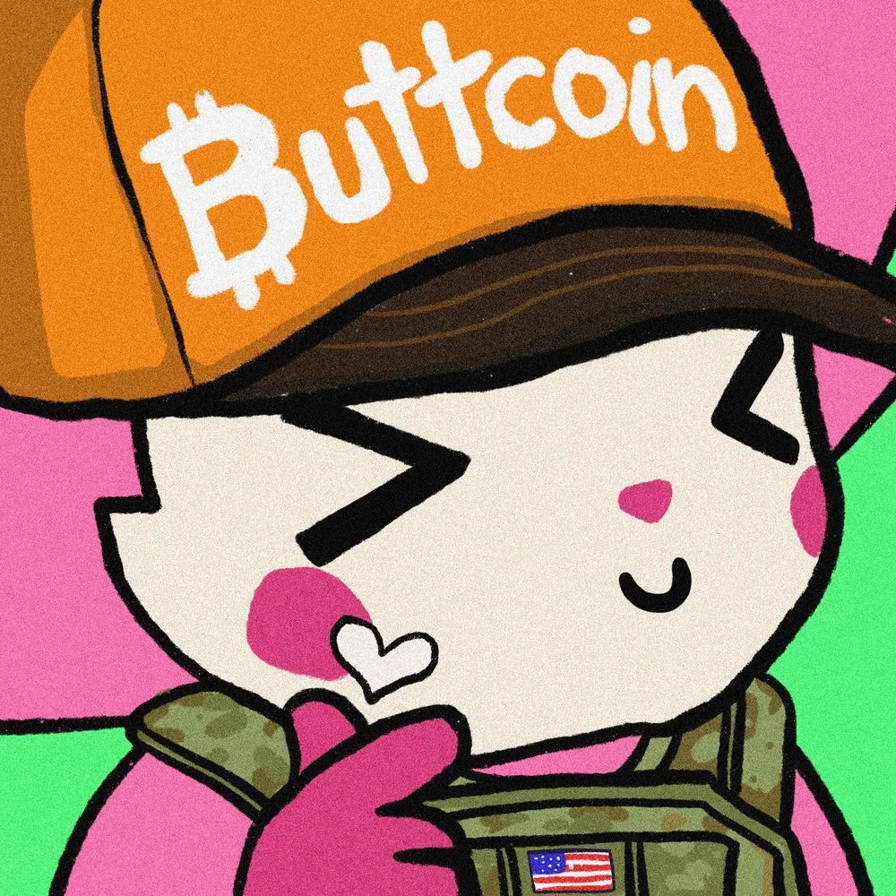
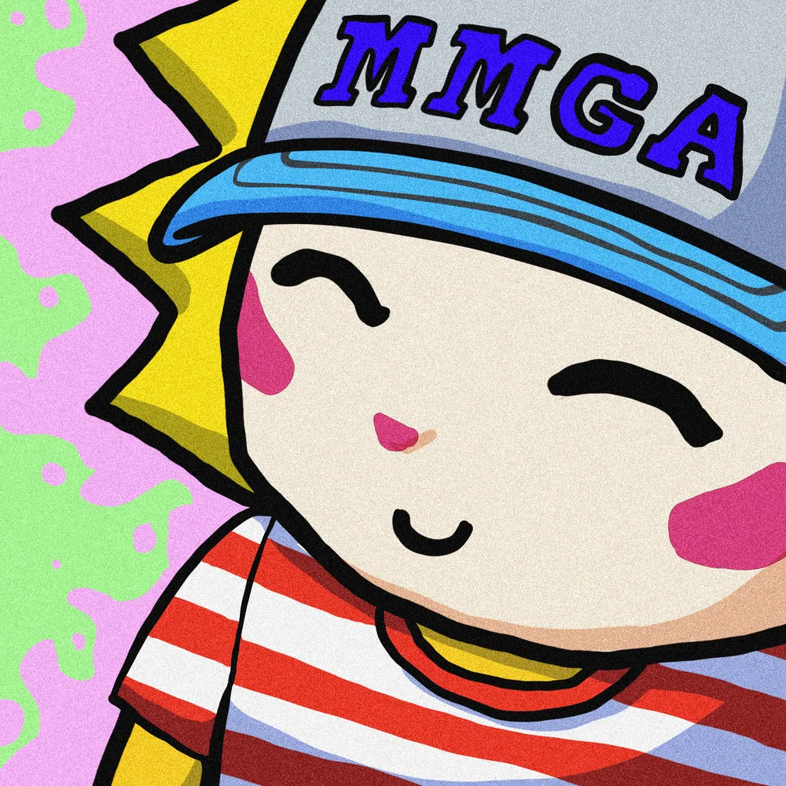
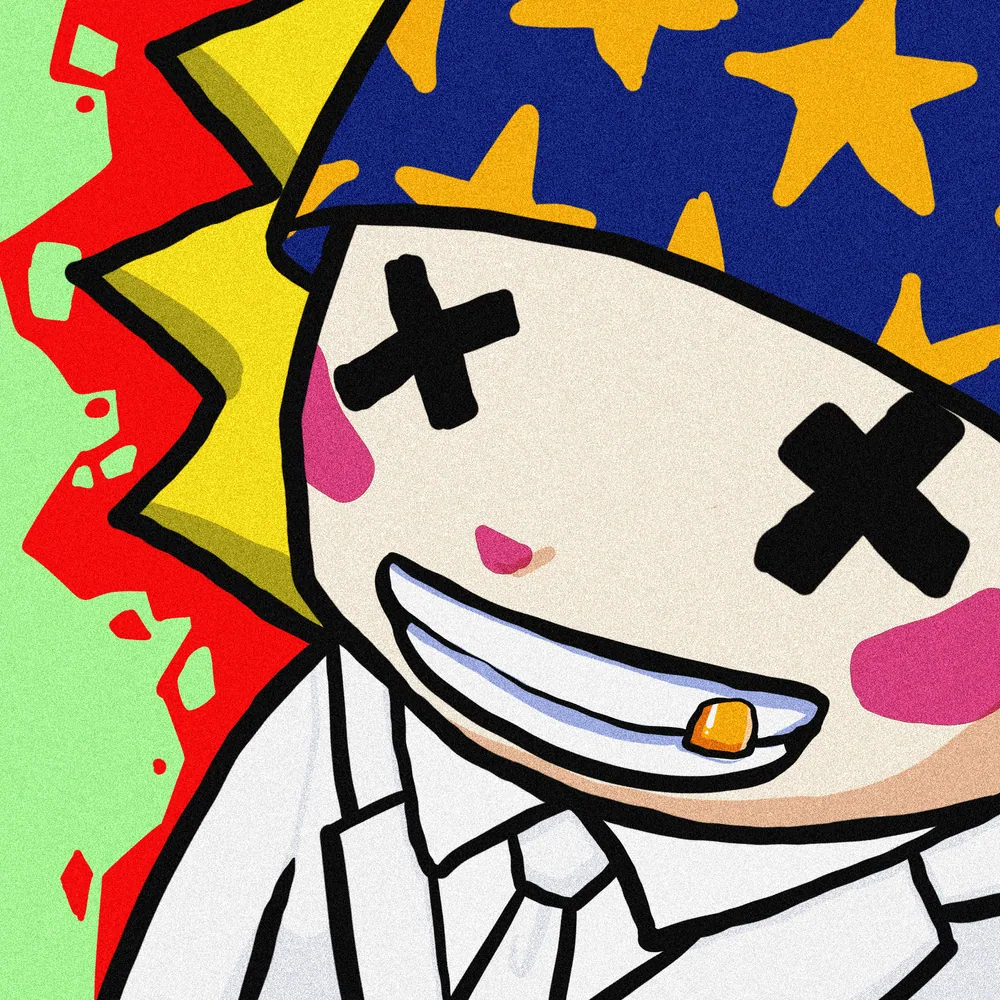
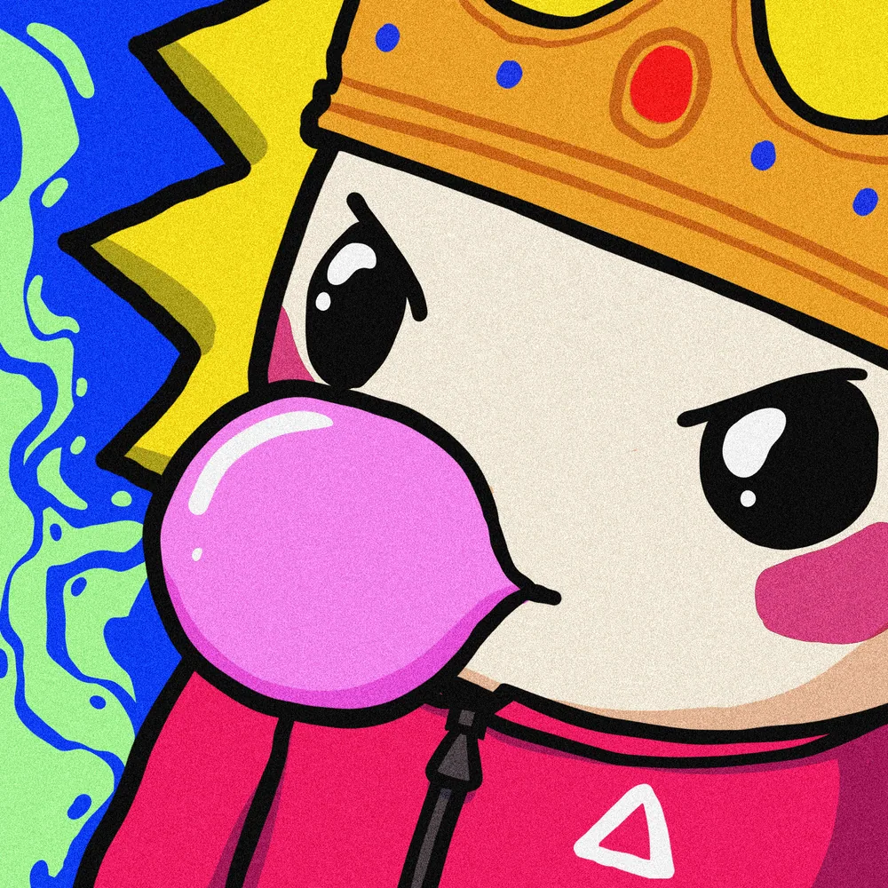
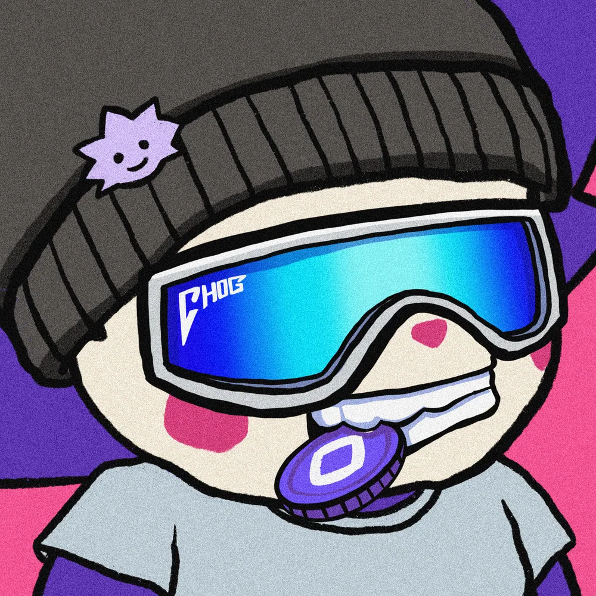
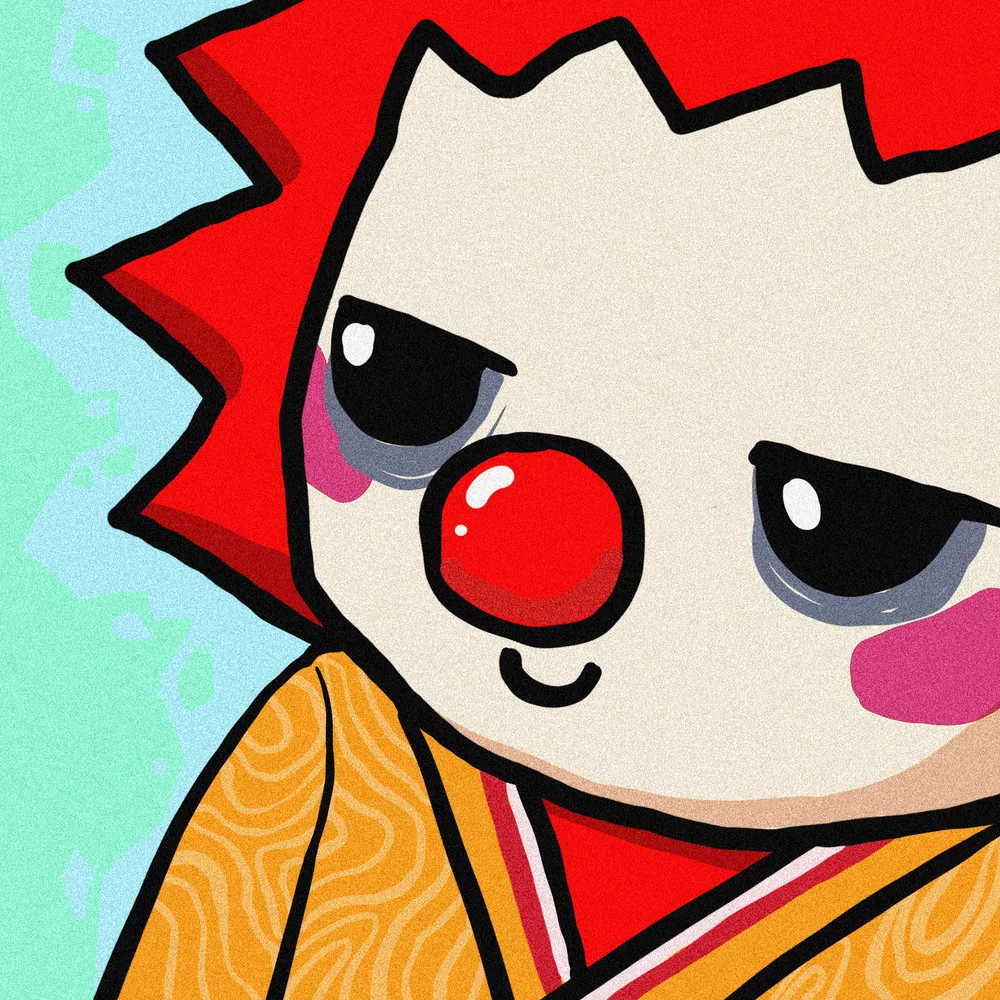
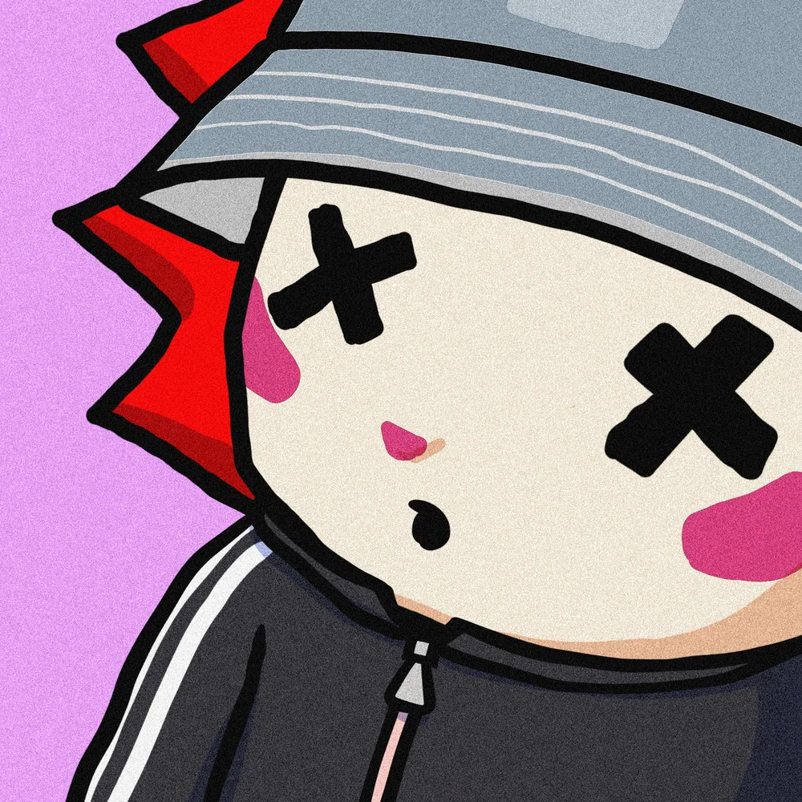
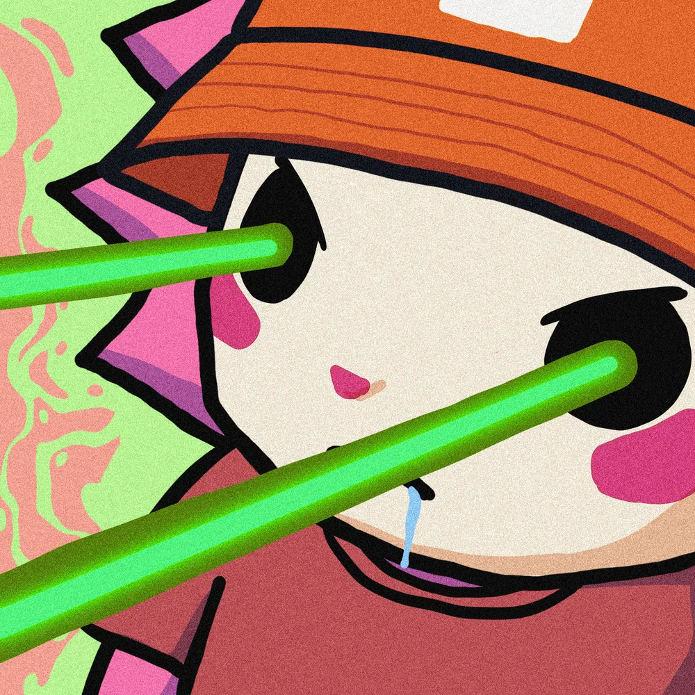

# Meet the twelve — Pip character gallery

**No candidate selected. Awaiting your approval.** Pip is a fictional role, not an official metadata rename or project endorsement. This is casting, not shopping: no price or rarity ranking.

[Polished Android preview](review/pip-gallery-polished-android.jpg) · [Polished desktop preview](review/pip-gallery-polished-desktop.jpg) · [Genesis collection](https://opensea.io/collection/chog-genesis) · [Canonical contract](https://monadvision.com/address/0xc96d31f8626c6d03fae5dcd3d61e3fb9f4a73763) · [Complete provenance packet](../public/nft-candidates/provenance.json)

**Monad mainnet 143 · block 115063901** · hash `0xc3959c32422d7e3965d35bef9846a922d424b49fcf9bf0c9faf186230532a488` · verified 2026-10-20T14:30:42.617Z. Existence and tokenURI were read at this single block; owner addresses were discarded. All files are unaltered originals from the actual tokenURI, not generated approximations. Local SHA-256 hashes are recorded, but IPFS CID verification is not independently performed.

**Verification: 12/12 passed; 0 failed.** No candidates excluded. The eight marketplace-preliminary options are now independently RPC/metadata/file-verified, alongside the original four.

The consolidated app gallery at `/archive/pip-candidates` has one card per original, search by ID/name/trait, four archetype filters, expandable complete traits and provenance. It runs locally from this branch; no deployment is implied by these GitHub previews. [Independent recheck of the additional eight](PIP_ROUND2_RECHECK.json).

## Compare the cast

Tap an artwork or token label to read the full dossier below. All character interpretations are fiction, not metadata traits or claims about holders.

### Playful adventure companion

| Option | Option |
| --- | --- |
|  **[Token 1969](#token-1969)** CHOG #1461 |  **[Token 969](#token-969)** CHOG #461 |
|  **[Token 1552](#token-1552)** CHOG #1044 |  **[Token 1053](#token-1053)** CHOG #545 |

### Mystery / secret-keeper

| Option | Option |
| --- | --- |
|  **[Token 42](#token-42)** CHOG #1503 |  **[Token 846](#token-846)** CHOG #338 |
|  **[Token 1848](#token-1848)** CHOG #1340 |  **[Token 512](#token-512)** CHOG #4 |

### Dry comic relief

| Option | Option |
| --- | --- |
|  **[Token 1428](#token-1428)** CHOG #920 |  **[Token 1620](#token-1620)** CHOG #1112 |

### Dangerous-looking ally

| Option | Option |
| --- | --- |
|  **[Token 1968](#token-1968)** CHOG #1460 |  **[Token 467](#token-467)** CHOG #1928 |

## Full dossiers

### Token 1969

**Metadata name: CHOG #1461** · Chog Genesis · Playful adventure companion (fictional grouping)

**Why Pip?** The Smirk, Bubblegum and Coin traits suggest a cheeky Pip who pockets an archive clue, blows a bubble, and pretends nothing happened.

**Original description:** CHOG — a 1969-piece collection on Monad.

**Actual collection traits:** Background: Deep Blue; Aura: Smoke; Base: Origin; Skin: Origin; Side: Left; Body: dark jacket; Mouth: Bubblegum; Eyes: Smirk; Head: Chog Cap; Accessory: Coin; Form: Chog; Tier: Uncommon; Naked: No.

[Genesis collection](https://opensea.io/collection/chog-genesis) · [Token on OpenSea](https://opensea.io/item/monad/0xc96d31f8626c6d03fae5dcd3d61e3fb9f4a73763/1969) · [Source metadata](https://ipfs.filebase.io/ipfs/bafybeid4ybujnscdipkno7ps5utqelp5ry5ryreqhay3zhgk3a6x4jruqu/1461.json) · [Frozen raw JSON](../public/nft-candidates/token-1969.json) · [Original art gateway](https://gateway.pinata.cloud/ipfs/bafybeihau2egcccbdxymeckmmbrqytbfor5gkt3en6d5fsbueymdbq7g6e/1461.webp)

- Onchain tokenURI: `ipfs://bafybeid4ybujnscdipkno7ps5utqelp5ry5ryreqhay3zhgk3a6x4jruqu/1461.json`
- Original artwork URI: `ipfs://bafybeihau2egcccbdxymeckmmbrqytbfor5gkt3en6d5fsbueymdbq7g6e/1461.webp`
- File: image/webp, 1000×1000; artwork SHA-256: `711ef9689122f1d03d65a1c1cef9b3efc3c73cc3de35e11b57c5f809c458d876`
- Raw metadata SHA-256: `d5f9d63b8d642f6b74216d9f70a137c26dc6825edf6493fdb52e9e61760b4cf5`

### Token 969

**Metadata name: CHOG #461** · Chog Genesis · Playful adventure companion (fictional grouping)

**Why Pip?** The Round Tear eyes, normal smile and Cream Tuxedo could give a mischievous Pip an innocent-looking disguise for elaborate pranks and mock-apologetic escapes.

**Original description:** CHOG — a 1969-piece collection on Monad.

**Actual collection traits:** Background: Soft Lavender; Aura: Light Purple; Base: Origin; Skin: Yellow; Side: Right; Body: Cream Tuxedo; Mouth: normal smile; Eyes: Round Tear; Head: Mon Cap; Form: Chog; Tier: Common; Naked: No.

[Genesis collection](https://opensea.io/collection/chog-genesis) · [Token on OpenSea](https://opensea.io/item/monad/0xc96d31f8626c6d03fae5dcd3d61e3fb9f4a73763/969) · [Source metadata](https://gateway.pinata.cloud/ipfs/bafybeid4ybujnscdipkno7ps5utqelp5ry5ryreqhay3zhgk3a6x4jruqu/461.json) · [Frozen raw JSON](../public/nft-candidates/token-969.json) · [Original art gateway](https://gateway.pinata.cloud/ipfs/bafybeihau2egcccbdxymeckmmbrqytbfor5gkt3en6d5fsbueymdbq7g6e/461.webp)

- Onchain tokenURI: `ipfs://bafybeid4ybujnscdipkno7ps5utqelp5ry5ryreqhay3zhgk3a6x4jruqu/461.json`
- Original artwork URI: `ipfs://bafybeihau2egcccbdxymeckmmbrqytbfor5gkt3en6d5fsbueymdbq7g6e/461.webp`
- File: image/webp, 1000×1000; artwork SHA-256: `ff72b96ab121fec4b686fd1c4d335fd85b68cd904530b79830d5048101823664`
- Raw metadata SHA-256: `02a33cad15ae06d4e52767963b15c3a3cc3ddd00be81d119c9fe02d679e0f448`

### Token 1552

**Metadata name: CHOG #1044** · Chog Genesis · Playful adventure companion (fictional grouping)

**Why Pip?** The XD eyes, Smile and Heart accessory could make Pip an exuberant prankster whose Army Vest cannot hide a soft spot for Neri.

**Original description:** CHOG — a 1969-piece collection on Monad.

**Actual collection traits:** Background: Lime Green; Base: Origin; Skin: Pink; Side: Left; Body: Army Vest; Mouth: Smile; Eyes: XD; Head: Buttcoin Cap; Accessory: Heart; Form: Chog; Tier: Uncommon; Naked: No.

[Genesis collection](https://opensea.io/collection/chog-genesis) · [Token on OpenSea](https://opensea.io/item/monad/0xc96d31f8626c6d03fae5dcd3d61e3fb9f4a73763/1552) · [Source metadata](https://gateway.pinata.cloud/ipfs/bafybeid4ybujnscdipkno7ps5utqelp5ry5ryreqhay3zhgk3a6x4jruqu/1044.json) · [Frozen raw JSON](../public/nft-candidates/token-1552.json) · [Original art gateway](https://gateway.pinata.cloud/ipfs/bafybeihau2egcccbdxymeckmmbrqytbfor5gkt3en6d5fsbueymdbq7g6e/1044.webp)

- Onchain tokenURI: `ipfs://bafybeid4ybujnscdipkno7ps5utqelp5ry5ryreqhay3zhgk3a6x4jruqu/1044.json`
- Original artwork URI: `ipfs://bafybeihau2egcccbdxymeckmmbrqytbfor5gkt3en6d5fsbueymdbq7g6e/1044.webp`
- File: image/webp, 1000×1000; artwork SHA-256: `30ef8605c9c80a91d1d7d6238200ecf3333faa388744e0d1b5b86834ba017aa6`
- Raw metadata SHA-256: `73bc53954011bfa8ee29e475c124315cf79ff17a96b45695af510ba8bdd84be4`

### Token 1053

**Metadata name: CHOG #545** · Chog Genesis · Playful adventure companion (fictional grouping)

**Why Pip?** The Happy eyes, Smile and Stripes could suit a cheerful Pip who turns every forbidden passage into a mischievous adventure.

**Original description:** CHOG — a 1969-piece collection on Monad.

**Actual collection traits:** Background: Fresh Green; Aura: Light Purple; Base: Origin; Skin: Yellow; Side: Right; Body: Stripes; Mouth: Smile; Eyes: Happy; Head: MMGA Cap; Form: Chog; Tier: Common; Naked: No.

[Genesis collection](https://opensea.io/collection/chog-genesis) · [Token on OpenSea](https://opensea.io/item/monad/0xc96d31f8626c6d03fae5dcd3d61e3fb9f4a73763/1053) · [Source metadata](https://gateway.pinata.cloud/ipfs/bafybeid4ybujnscdipkno7ps5utqelp5ry5ryreqhay3zhgk3a6x4jruqu/545.json) · [Frozen raw JSON](../public/nft-candidates/token-1053.json) · [Original art gateway](https://gateway.pinata.cloud/ipfs/bafybeihau2egcccbdxymeckmmbrqytbfor5gkt3en6d5fsbueymdbq7g6e/545.webp)

- Onchain tokenURI: `ipfs://bafybeid4ybujnscdipkno7ps5utqelp5ry5ryreqhay3zhgk3a6x4jruqu/545.json`
- Original artwork URI: `ipfs://bafybeihau2egcccbdxymeckmmbrqytbfor5gkt3en6d5fsbueymdbq7g6e/545.webp`
- File: image/webp, 1000×1000; artwork SHA-256: `47538955fbb298e3dc0b29f3f4e4f47f6a5c15f92f0e264295b59353be317b5c`
- Raw metadata SHA-256: `298de1bbc95adb946e40d9601a3b16bc2cfbb2e8d914819d49d132436d971037`

### Token 42

**Metadata name: CHOG #1503** · Chog Genesis · Mystery / secret-keeper (fictional grouping)

**Why Pip?** The Plumber headwear, BTC Coin and dark jacket could make Pip a sly gadget-tinkerer who rigs a harmless distraction before slipping through a secret exit.

**Original description:** CHOG — a 1969-piece collection on Monad.

**Actual collection traits:** Background: Deep Aqua; Aura: Smoke; Base: Origin; Skin: Pink; Side: Left; Body: dark jacket; Mouth: BTC Coin; Eyes: Base; Head: Plumber; Form: Chog; Tier: Uncommon; Naked: No.

[Genesis collection](https://opensea.io/collection/chog-genesis) · [Token on OpenSea](https://opensea.io/item/monad/0xc96d31f8626c6d03fae5dcd3d61e3fb9f4a73763/42) · [Source metadata](https://gateway.pinata.cloud/ipfs/bafybeid4ybujnscdipkno7ps5utqelp5ry5ryreqhay3zhgk3a6x4jruqu/1503.json) · [Frozen raw JSON](../public/nft-candidates/token-42.json) · [Original art gateway](https://gateway.pinata.cloud/ipfs/bafybeihau2egcccbdxymeckmmbrqytbfor5gkt3en6d5fsbueymdbq7g6e/1503.webp)

- Onchain tokenURI: `ipfs://bafybeid4ybujnscdipkno7ps5utqelp5ry5ryreqhay3zhgk3a6x4jruqu/1503.json`
- Original artwork URI: `ipfs://bafybeihau2egcccbdxymeckmmbrqytbfor5gkt3en6d5fsbueymdbq7g6e/1503.webp`
- File: image/webp, 1000×1000; artwork SHA-256: `1639968a95ac12ab21c4d9acd9510812f0fc5d8b0a5f0d5336cb39e4bfbb0542`
- Raw metadata SHA-256: `fbe777b10b0e690d488a57209547a5a4adee62754f11aa6e105cc45fda8b2652`

### Token 846

**Metadata name: CHOG #338** · Chog Genesis · Mystery / secret-keeper (fictional grouping)

**Why Pip?** The Wizard Hat, Gold Tooth and Dead eyes could frame Pip as a sly old secret-keeper who punctures ominous warnings with terrible jokes.

**Original description:** CHOG — a 1969-piece collection on Monad.

**Actual collection traits:** Background: Fresh Green; Aura: Fire; Base: Origin; Skin: Yellow; Side: Right; Body: White tuxedo; Mouth: Gold Tooth; Eyes: Dead; Head: Wizard Hat; Form: Chog; Tier: Common; Naked: No.

[Genesis collection](https://opensea.io/collection/chog-genesis) · [Token on OpenSea](https://opensea.io/item/monad/0xc96d31f8626c6d03fae5dcd3d61e3fb9f4a73763/846) · [Source metadata](https://ipfs.filebase.io/ipfs/bafybeid4ybujnscdipkno7ps5utqelp5ry5ryreqhay3zhgk3a6x4jruqu/338.json) · [Frozen raw JSON](../public/nft-candidates/token-846.json) · [Original art gateway](https://gateway.pinata.cloud/ipfs/bafybeihau2egcccbdxymeckmmbrqytbfor5gkt3en6d5fsbueymdbq7g6e/338.webp)

- Onchain tokenURI: `ipfs://bafybeid4ybujnscdipkno7ps5utqelp5ry5ryreqhay3zhgk3a6x4jruqu/338.json`
- Original artwork URI: `ipfs://bafybeihau2egcccbdxymeckmmbrqytbfor5gkt3en6d5fsbueymdbq7g6e/338.webp`
- File: image/webp, 1000×1000; artwork SHA-256: `11da0323d2a63ff762a30eef6d229582c6cb00ab7c88484adffba285de6ec091`
- Raw metadata SHA-256: `41f997e777c57636e3669f56e70a825ffc0240efec51738e9d0ee5a33cb60cad`

### Token 1848

**Metadata name: CHOG #1340** · Chog Genesis · Mystery / secret-keeper (fictional grouping)

**Why Pip?** The Crown, Bubblegum and Squid Game Guard outfit could suit a secretive Pip who mischievously impersonates authority to sneak Neri past a checkpoint.

**Original description:** CHOG — a 1969-piece collection on Monad.

**Actual collection traits:** Background: Fresh Green; Aura: Royal Blue Aura; Base: Origin; Skin: Yellow; Side: Right; Body: Squid Game Guard; Mouth: Bubblegum; Eyes: Normal Eye; Head: Crown; Form: Chog; Tier: Common; Naked: No.

[Genesis collection](https://opensea.io/collection/chog-genesis) · [Token on OpenSea](https://opensea.io/item/monad/0xc96d31f8626c6d03fae5dcd3d61e3fb9f4a73763/1848) · [Source metadata](https://gateway.pinata.cloud/ipfs/bafybeid4ybujnscdipkno7ps5utqelp5ry5ryreqhay3zhgk3a6x4jruqu/1340.json) · [Frozen raw JSON](../public/nft-candidates/token-1848.json) · [Original art gateway](https://gateway.pinata.cloud/ipfs/bafybeihau2egcccbdxymeckmmbrqytbfor5gkt3en6d5fsbueymdbq7g6e/1340.webp)

- Onchain tokenURI: `ipfs://bafybeid4ybujnscdipkno7ps5utqelp5ry5ryreqhay3zhgk3a6x4jruqu/1340.json`
- Original artwork URI: `ipfs://bafybeihau2egcccbdxymeckmmbrqytbfor5gkt3en6d5fsbueymdbq7g6e/1340.webp`
- File: image/webp, 1000×1000; artwork SHA-256: `74fb2f42d2d8dca692e95c8c0026fae7fb14c593de210b128315f0bc2580db75`
- Raw metadata SHA-256: `a4cf87d325be25dfd8391e31897c719337291222559590a12f1325a06f5f3e76`

### Token 512

**Metadata name: CHOG #4** · Chog Genesis · Mystery / secret-keeper (fictional grouping)

**Why Pip?** The Chog Viper eyes, Choggie Beanie and Mon coin could suit a sly archive thief whose coin obsession turns clue-hunting into mischief.

**Original description:** CHOG — a 1969-piece collection on Monad.

**Actual collection traits:** Background: Rosy Pink; Base: Origin; Skin: Origin; Side: Left; Body: Grey Shirt; Mouth: Mon coin; Eyes: Chog Viper; Head: Choggie Beanie; Form: Chog; Tier: Uncommon; Naked: No.

[Genesis collection](https://opensea.io/collection/chog-genesis) · [Token on OpenSea](https://opensea.io/item/monad/0xc96d31f8626c6d03fae5dcd3d61e3fb9f4a73763/512) · [Source metadata](https://gateway.pinata.cloud/ipfs/bafybeid4ybujnscdipkno7ps5utqelp5ry5ryreqhay3zhgk3a6x4jruqu/4.json) · [Frozen raw JSON](../public/nft-candidates/token-512.json) · [Original art gateway](https://gateway.pinata.cloud/ipfs/bafybeihau2egcccbdxymeckmmbrqytbfor5gkt3en6d5fsbueymdbq7g6e/4.webp)

- Onchain tokenURI: `ipfs://bafybeid4ybujnscdipkno7ps5utqelp5ry5ryreqhay3zhgk3a6x4jruqu/4.json`
- Original artwork URI: `ipfs://bafybeihau2egcccbdxymeckmmbrqytbfor5gkt3en6d5fsbueymdbq7g6e/4.webp`
- File: image/webp, 1000×1000; artwork SHA-256: `c2054a4ecf68b5163a40d884997f07aff6b6caab970f6528a441305e4b0038b7`
- Raw metadata SHA-256: `6122fa9685f22d7dfbf5c81aed61b1ec35e861b23fdaf4d12152530f4eeca659`

### Token 1428

**Metadata name: CHOG #920** · Chog Genesis · Dry comic relief (fictional grouping)

**Why Pip?** The Tired eyes and Clown Nose could make Pip a deadpan trickster who insists the latest absurd distraction was entirely intentional.

**Original description:** CHOG — a 1969-piece collection on Monad.

**Actual collection traits:** Background: Aqua Mint; Aura: Cool Aura; Base: Origin; Skin: Red; Side: Right; Body: Yellow Yukata; Mouth: Smile; Eyes: Tired; Head: Clown Nose; Form: Chog; Tier: Common; Naked: No.

[Genesis collection](https://opensea.io/collection/chog-genesis) · [Token on OpenSea](https://opensea.io/item/monad/0xc96d31f8626c6d03fae5dcd3d61e3fb9f4a73763/1428) · [Source metadata](https://gateway.pinata.cloud/ipfs/bafybeid4ybujnscdipkno7ps5utqelp5ry5ryreqhay3zhgk3a6x4jruqu/920.json) · [Frozen raw JSON](../public/nft-candidates/token-1428.json) · [Original art gateway](https://gateway.pinata.cloud/ipfs/bafybeihau2egcccbdxymeckmmbrqytbfor5gkt3en6d5fsbueymdbq7g6e/920.webp)

- Onchain tokenURI: `ipfs://bafybeid4ybujnscdipkno7ps5utqelp5ry5ryreqhay3zhgk3a6x4jruqu/920.json`
- Original artwork URI: `ipfs://bafybeihau2egcccbdxymeckmmbrqytbfor5gkt3en6d5fsbueymdbq7g6e/920.webp`
- File: image/webp, 1000×1000; artwork SHA-256: `677d6f2b786ef702c0fa577cd977cadc03b69bac55917913c569ce42ded55835`
- Raw metadata SHA-256: `8101d3af4733435bfb94b3f231311242007162600a3b4baa0b16085822bea9b3`

### Token 1620

**Metadata name: CHOG #1112** · Chog Genesis · Dry comic relief (fictional grouping)

**Why Pip?** The Dead eyes, Gray Bucket Cap and Black Trackset could suit a dryly comic Pip who delivers one unimpressed remark while quietly orchestrating a prank.

**Original description:** CHOG — a 1969-piece collection on Monad.

**Actual collection traits:** Background: Light Purple; Base: Origin; Skin: Red; Side: Right; Body: Black Trackset; Mouth: wo; Eyes: Dead; Head: Gray Bucket Cap; Form: Chog; Tier: Common; Naked: No.

[Genesis collection](https://opensea.io/collection/chog-genesis) · [Token on OpenSea](https://opensea.io/item/monad/0xc96d31f8626c6d03fae5dcd3d61e3fb9f4a73763/1620) · [Source metadata](https://gateway.pinata.cloud/ipfs/bafybeid4ybujnscdipkno7ps5utqelp5ry5ryreqhay3zhgk3a6x4jruqu/1112.json) · [Frozen raw JSON](../public/nft-candidates/token-1620.json) · [Original art gateway](https://gateway.pinata.cloud/ipfs/bafybeihau2egcccbdxymeckmmbrqytbfor5gkt3en6d5fsbueymdbq7g6e/1112.webp)

- Onchain tokenURI: `ipfs://bafybeid4ybujnscdipkno7ps5utqelp5ry5ryreqhay3zhgk3a6x4jruqu/1112.json`
- Original artwork URI: `ipfs://bafybeihau2egcccbdxymeckmmbrqytbfor5gkt3en6d5fsbueymdbq7g6e/1112.webp`
- File: image/webp, 1000×1000; artwork SHA-256: `51c755095cb8bdd66ef5136455ea93062778a954f11c8e5ee588ba365474e763`
- Raw metadata SHA-256: `bc6d98b4277abdbda06223e5952f243460ab6b92edd547913fd461502ac4a23d`

### Token 1968

**Metadata name: CHOG #1460** · Chog Genesis · Dangerous-looking ally (fictional grouping)

**Why Pip?** The Demon Horn, Burning Aura and Red Round Eye traits could suit a mischievous Pip who stages theatrical jump scares, then turns the fright into a joke.

**Original description:** CHOG — a 1969-piece collection on Monad.

**Actual collection traits:** Background: Radioactive; Aura: Burning Aura; Base: Radioactive; Skin: Red; Side: Left; Body: White Sleeveless; Eyes: Red Round Eye; Head: Demon Horn; Form: Chog; Tier: Epic; Naked: No.

[Genesis collection](https://opensea.io/collection/chog-genesis) · [Token on OpenSea](https://opensea.io/item/monad/0xc96d31f8626c6d03fae5dcd3d61e3fb9f4a73763/1968) · [Source metadata](https://gateway.pinata.cloud/ipfs/bafybeid4ybujnscdipkno7ps5utqelp5ry5ryreqhay3zhgk3a6x4jruqu/1460.json) · [Frozen raw JSON](../public/nft-candidates/token-1968.json) · [Original art gateway](https://gateway.pinata.cloud/ipfs/bafybeihau2egcccbdxymeckmmbrqytbfor5gkt3en6d5fsbueymdbq7g6e/1460.webp)

- Onchain tokenURI: `ipfs://bafybeid4ybujnscdipkno7ps5utqelp5ry5ryreqhay3zhgk3a6x4jruqu/1460.json`
- Original artwork URI: `ipfs://bafybeihau2egcccbdxymeckmmbrqytbfor5gkt3en6d5fsbueymdbq7g6e/1460.webp`
- File: image/webp, 1000×1000; artwork SHA-256: `05bf2bac6eb6df26a0a6ec76b0c38dec6b4a138b9b9a3ddd94d7677c0009cb0d`
- Raw metadata SHA-256: `95f215c6271cb9e82e2e442b95422c1b96b80461355e0cb4ecf5b187a9e1a617`

### Token 467

**Metadata name: CHOG #1928** · Chog Genesis · Dangerous-looking ally (fictional grouping)

**Why Pip?** The Green laser eyes, Drooling and Orange Bucket Cap could make Pip a chaotic-looking ally whose ridiculous diversions hide surprisingly useful clues.

**Original description:** CHOG — a 1969-piece collection on Monad.

**Actual collection traits:** Background: Peach Pink; Aura: Mint; Base: Origin; Skin: Pink; Side: Right; Body: Red shirt; Mouth: Drooling; Eyes: Green laser; Head: Orange Bucket Cap; Form: Chog; Tier: Common; Naked: No.

[Genesis collection](https://opensea.io/collection/chog-genesis) · [Token on OpenSea](https://opensea.io/item/monad/0xc96d31f8626c6d03fae5dcd3d61e3fb9f4a73763/467) · [Source metadata](https://gateway.pinata.cloud/ipfs/bafybeid4ybujnscdipkno7ps5utqelp5ry5ryreqhay3zhgk3a6x4jruqu/1928.json) · [Frozen raw JSON](../public/nft-candidates/token-467.json) · [Original art gateway](https://gateway.pinata.cloud/ipfs/bafybeihau2egcccbdxymeckmmbrqytbfor5gkt3en6d5fsbueymdbq7g6e/1928.webp)

- Onchain tokenURI: `ipfs://bafybeid4ybujnscdipkno7ps5utqelp5ry5ryreqhay3zhgk3a6x4jruqu/1928.json`
- Original artwork URI: `ipfs://bafybeihau2egcccbdxymeckmmbrqytbfor5gkt3en6d5fsbueymdbq7g6e/1928.webp`
- File: image/webp, 1000×1000; artwork SHA-256: `d4a44ebca5a31a282d78fe5222f41b9c8fad66f314f81922f5b5bc31a4709e75`
- Raw metadata SHA-256: `03ae8311668c1b16f0eadac0a4605bcf34fde4a573af68486deab3cebb2a20bc`

## Your approval comes first

Reply with an **onchain token ID**, request another shortlist, or leave all unselected. No wallet action, purchase, signature, gas spend, contract or site deployment has occurred. Public NFT metadata does not grant artwork adaptation rights; media remains paused pending explicit selection and rights review. No generated or derivative Chog art was made.

The public web gallery route is `/archive/pip-candidates` when running this branch locally. These GitHub links are source/image previews, not a deployed-site claim. The brief is [PIP_CASTING_ROUND2.md](PIP_CASTING_ROUND2.md). To refresh: `npx tsx scripts/verify-pip-candidates.ts`, then `npx tsx scripts/write-pip-gallery.ts`; review all new results and do not assume future reads match this dated snapshot.
